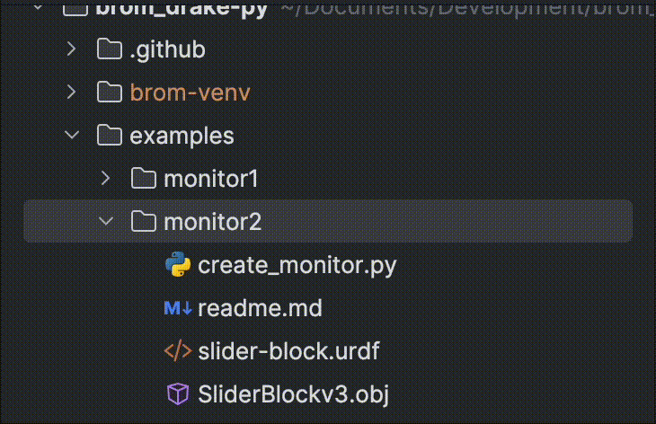
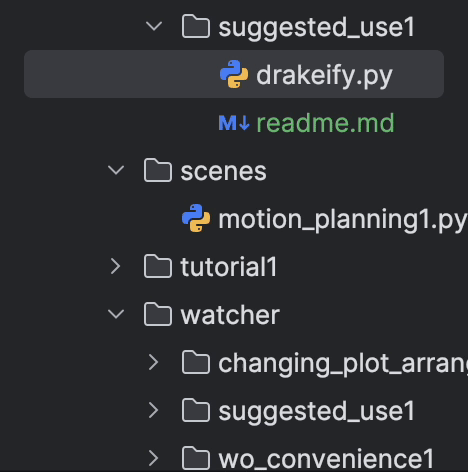
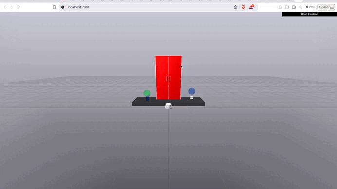
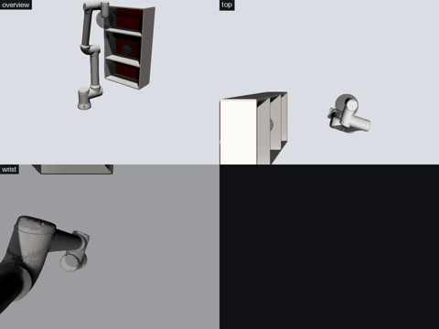

[](https://codecov.io/gh/kwesiRutledge/brom_drake-py)
[](https://kwesirutledge.github.io/brom_drake-py/)

# brom_drake-py
Brom is a helper library for the [Drake](https://drake.mit.edu/) robotics simulation and verification library.
Its goal is to simplify common debugging and testing activities in Drake (for example, logging the outputs
of systems in your block diagrams). 

Some of Brom's features:

Feature                    |  Code | Results
:-------------------------:|:-------------------------:|:-------------------------:
The Diagram Watcher (the `DiagramWatcher` will log + plot all output ports of your `Diagram` automatically) |`add_watcher_and_build()`| 
The Drake-ify feature (converts your URDF file into a form that Drake can consume) | `drakeify_my_urdf()` | 
Productions (partially complete robot scenarios to test your algorithms) | (See [Examples Directory](https://github.com/kwesiRutledge/brom_drake-py/tree/main/examples/productions) or [the Docs](https://kwesirutledge.github.io/brom_drake-py/)) | 
Puppeteer (Move free bodies in drake with a `RigidTransform` input) | `Puppetmaker` class's methods | 
Video recording (record MP4s of any production, or your own diagram, from one or more cameras) | `production.add_cameras()` then `production.save_videos(grid=True)` | 

To learn more, look through our documentation [here](https://kwesirutledge.github.io/brom_drake-py/).

## Installation

`brom_drake` is available on PyPI and installable with pip:

```shell
pip install brom-drake
```

### Video recording install

To record videos of your simulations (see `add_cameras()` in the docs), install the optional video extra:

```shell
pip install "brom-drake[video]"
```

On Linux machines without a display (CI, containers), Drake's renderer also needs the EGL system libraries:

```shell
sudo apt-get install libegl1 libegl-mesa0 libgl1-mesa-dri libopengl0
```

### ROS 2-capable install

If you use ROS 2 package URIs (for example, `package://...`) and want
`brom_drake` to resolve package share directories via `ament_index_python`,
install the optional ROS 2 extra:

```shell
pip install "brom-drake[ros2]"
```

In most ROS 2 workflows, make sure your ROS 2 environment is sourced before
running your scripts so package discovery works as expected.

### Developer install

You can also install the package during local development by cloning
the repository and running the following commands from inside it:

```bash
pip install -r requirements.txt
pip install -e .
```

### Recurring documentation proposals

`.github/workflows/documentation-one-file.md` defines a GitHub Agentic Workflow
that runs every Monday at 09:00 UTC or via manual dispatch. It proposes at most
one draft PR improving one existing Sphinx page or a Python file's rendered
docstrings, and skips proposals while a `[docs-one-file]` PR is open. Each
proposal must preserve executable Python structure and build Sphinx HTML without
adding warnings relative to the run's baseline.

Before running it, configure the repository's `COPILOT_GITHUB_TOKEN` Actions
secret with a Copilot-enabled token as described in the
[engine authentication guide](https://github.github.com/gh-aw/reference/engines/#github-copilot-default),
and enable **Allow GitHub Actions to create and approve pull requests** in
**Settings > Actions > General**. The workflow uses `PYTHON_VERSION` if set,
otherwise Python 3.14; the selected version must meet `setup.py`'s requirements.

After editing the workflow Markdown, regenerate and commit its `.lock.yml`:

```bash
gh extension install github/gh-aw
gh aw compile documentation-one-file
```

The checked-in lock file was generated with `gh-aw` v1.0.1. Review regenerated
files when upgrading the compiler; do not edit the lock file by hand. Merging a
documentation proposal does not deploy the public site: deployment remains
tag-triggered or manually dispatched through the existing Sphinx workflow.

## Citation

Feel free to cite this project if it helped with your work!

```
@misc{bromDrake2024,
  author = "Kwesi Rutledge and the Wrench Robotics Team",
  title = "Brom: A Helper Library for the Drake Toolbox",
  year = 2024,
}
```

## FAQs

### Why the name Brom?

[Brom the storyteller](https://inheritance.fandom.com/wiki/Brom) is a character from the
[Inheritance](https://en.wikipedia.org/wiki/Eragon) series by Christopher Paolini.
He is a wise mentor that helps Eragon (the protagonist) master dragons. ;)

### Where are the release notes?

You can follow the development of Brom by:
- Following the Release Notes on Substack ([[Substack](https://bromreleasenotes.substack.com/)])
- Studying the Pull Requests (available above in the `Pull Requests` tab of GitHub), or

### How can I support this project?

Feel free to create an issue/send the Wrench Robotics team a message if you're interested in helping out!

## Related Work

Some other work in the open-source Drake community:
- [kinova_drake](https://github.com/vincekurtz/kinova_drake) - A Drake-based library that builds a 
  simple version of the manipulation station for the Kinova Gen3 robot arm.
  Also works with the hardware.
- [airo-drake](https://github.com/airo-ugent/airo-drake) - A python package meant to simplify
  working with Drake and the `airo-mono` repository from the AI and Robotics Lab at Ghent University.

## To-Dos

- [ ] Figure out how to tell if two systems are connected in Drake.
- [ ] Add more readme explanations of what is going on under the hood.
- [ ] Create a method that makes each material in a URDF file have unique names if they have specific values
- [ ] Allow for the user to give "Drake-unfriendly" URDFs to `ShowMeThisModel` production
