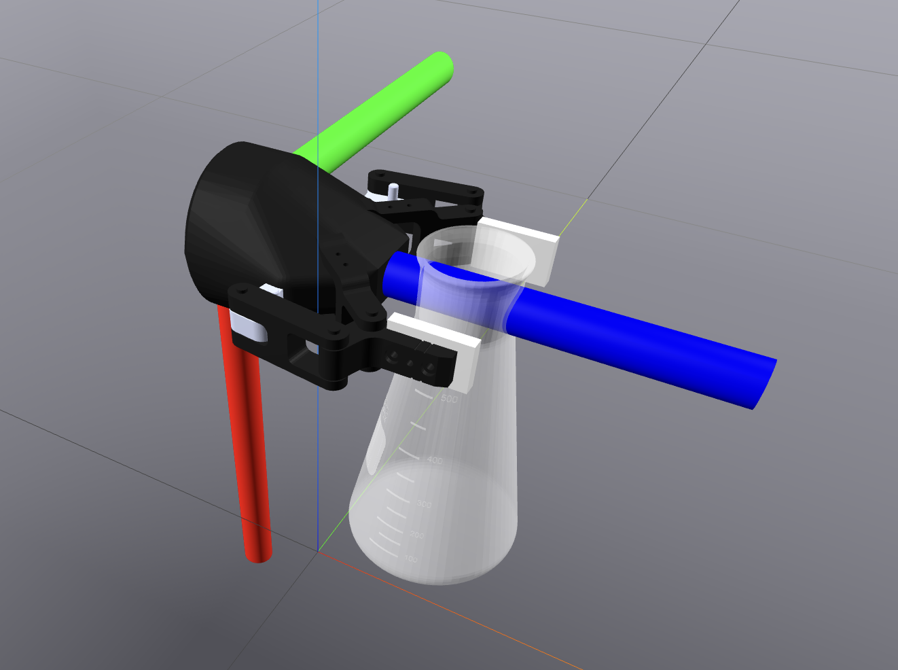
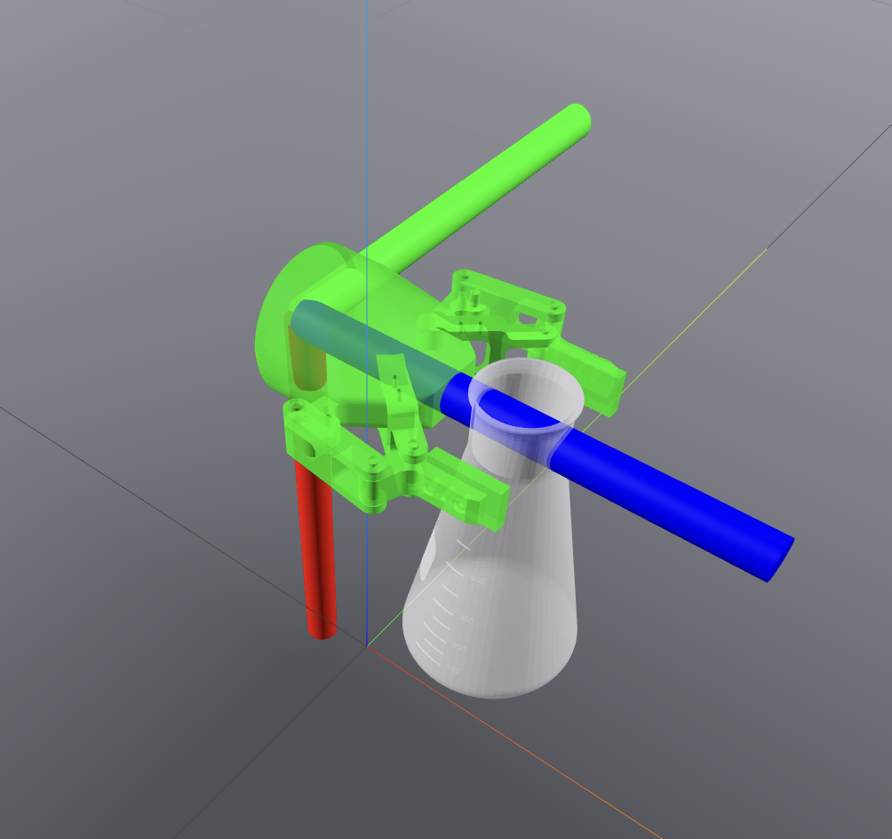

Show Me This Static Grasp
=========================

*Want to see what a grasp would look like when "frozen" in time?*
*Use this*
:code:`Production`
*to easily "show" a gripper with a given pose w.r.t. an object that you would like to grasp!*

Introduction
------------

Grasping algorithms can be difficult to debug. 
These algorithms normally are used in combination with motion planners and control algorithms that will position an arm in place before attempting a grasp and, so, it can often be hard to debug just your grasping algorithm. 
This :code:`Production` was meant to help with this mission!

We created :py:class:`~brom_drake.productions.debug.grasping.show_me_this_static_grasp.production.ShowMeThisStaticGrasp` 
so that you can easily see what your ideal grasp looks like for a specific object. 
Simply give your object model, your gripper model and (optionally) data like the pose of the gripper with respect to the object and we will immediately show you what the grasp looks like in the 3D viewer without having to get any other algorithms/systems involved.

Example Usage
-------------

You can view multiple examples for this :code:`Production` object in our
:code:`examples/productions/helpful_for_debugging/grasping/demonstrate_static_grasp` directory.

In this section, we will include one smaller example that has been visualized above.

.. code-block:: python

    from importlib import resources as impresources
    import ipdb
    import numpy as np
    from pydrake.all import (
        Simulator,
        RollPitchYaw, RigidTransform,
    )
    import typer

    # Internal Imports
    from brom_drake.all import drakeify_my_urdf
    from brom_drake import robots
    from brom_drake.productions.all import (
        ShowMeThisStaticGrasp,
        ShowMeThisStaticGraspConfiguration,
    )

    def main(meshcat_port_number: int = 7001):
        """
        Description
        -----------
        This test verifies how we can use the add_cast_and_build method
        to build a DemonstrateStaticGrasp production.
        """
        # Setup

        # Create erlenmeyer flask urdf
        erlenmeyer_flask_file = str(
            impresources.files(robots) / "models/erlenmeyer_flask/500ml.urdf"
        )

        drakeified_flask_urdf = drakeify_my_urdf(
            erlenmeyer_flask_file,
            overwrite_old_logs=True,
            log_file_name="DemonstrateStaticGripTest_AddManipulandToPlant_flask.log",
        )

        # Create the gripper urdf
        gripper_urdf = str(
            impresources.files(robots) / "models/robotiq/2f_85_gripper-no-mimic/urdf/robotiq_2f_85.urdf"
        )    
        
        X_ObjectTarget = RigidTransform(
            p=np.array([-0.08, 0.05, 0.15]),
            rpy=RollPitchYaw(0.0, np.pi/2.0, 0.0),
        )

        # Create the production
        config = ShowMeThisStaticGraspConfiguration()
        config.meshcat_port_number = meshcat_port_number # Use None for CI
        production = ShowMeThisStaticGrasp(
            path_to_object=str(drakeified_flask_urdf),
            path_to_gripper=gripper_urdf,
            X_ObjectGripper=X_ObjectTarget,
            config=config,
        )

        # Call the method
        diagram, diagram_context = production.add_cast_and_build()

        # Set up simulation
        simulator = Simulator(diagram, diagram_context)
        simulator.set_target_realtime_rate(1.0)
        simulator.set_publish_every_time_step(False)
        simulator.Initialize()
        simulator.AdvanceTo(10.0)

    if __name__ == "__main__":
        main()

The result of this script will be the simulation shown at the start of this page.

How it works
^^^^^^^^^^^^

The constructor takes the following arguments:

- :code:`path_to_object` and :code:`path_to_gripper`: (Required) Paths to the object and gripper model files.
- :code:`X_ObjectGripper`: (Optional) A :code:`RigidTransform` giving the pose, with respect to the object, of the gripper's *target body* (see :code:`target_body_on_gripper` below). If it is :code:`None`, the identity transform is used.
- :code:`gripper_joint_positions`: (Optional) The joint positions at which the gripper is held. If it is :code:`None`, every gripper joint is set to zero.
- :code:`config`: (Optional) A :code:`ShowMeThisStaticGraspConfiguration`. Its :code:`meshcat_port_number` (reached through :code:`config.base`) and the fields below are not constructor arguments of their own; set them on the configuration. If it is :code:`None`, a default configuration is used.

The configuration's :code:`target_body_on_gripper` names the gripper body whose pose is :code:`X_ObjectGripper`.
If it is :code:`None`, the first body in the gripper model is used; a name that is not in the gripper model raises an :code:`AssertionError` that lists the valid names.
The object is welded to the world frame, and the gripper is welded at the pose that places its target body at :code:`X_ObjectGripper` relative to the object.

Modifying the Gripper's Visual Geometries
^^^^^^^^^^^^^^^^^^^^^^^^^^^^^^^^^^^^^^^^^

By default, the visualizer shows the visual (illustration) geometries.
Setting :code:`config.show_collision_geometries = True` shows the collision (proximity) geometries instead.
The :code:`gripper_color` option, in contrast, does not change which geometries are shown: it recolors the gripper's visual elements with an RGBA list.

For example, we can change the color of the gripper to be green and semi-transparent with the following code:

.. code-block:: python

    # Create the config for the production
    config = ShowMeThisStaticGraspConfiguration()
    config.meshcat_port_number = meshcat_port_number
    config.gripper_color = [0.0, 1.0, 0.0, 0.6] # Green

    # Create production
    production = ShowMeThisStaticGrasp(
        path_to_object=str(drakeified_flask_urdf),
        path_to_gripper=gripper_urdf,
        X_ObjectGripper=X_ObjectTarget,
        config=config
    )

The result of this script will be the following simulation:

