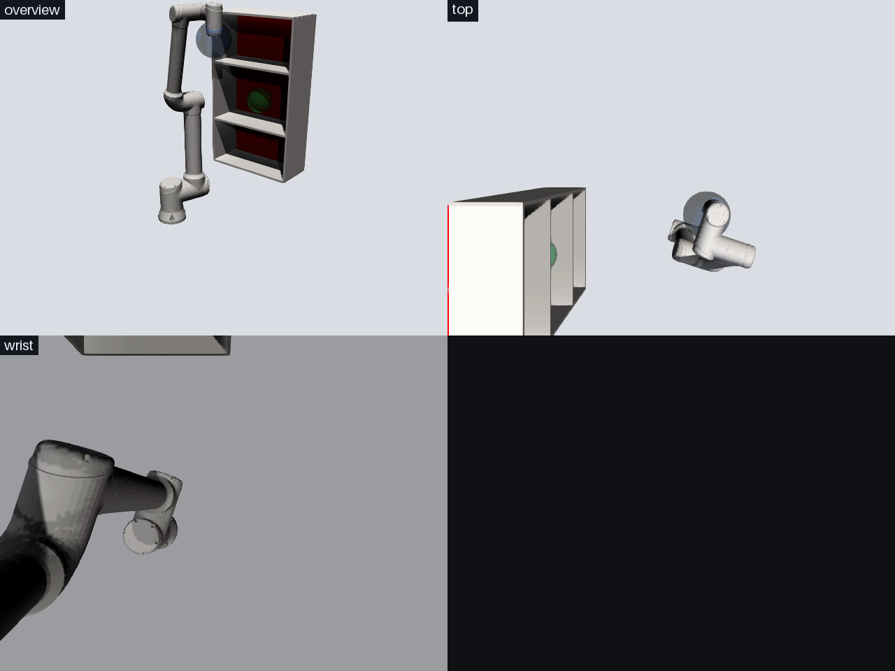
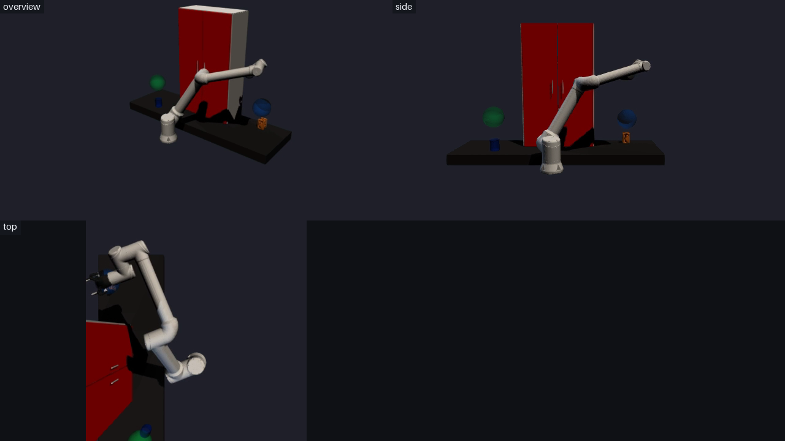

Recording Videos
================

*Record MP4 videos of any production (or your own Drake diagram) from one or more cameras.*

Introduction
------------

A video is often the fastest way to show what a simulation did: in a pull
request, in a bug report, or to a colleague who doesn't have Drake installed.
Brom can record any :py:class:`~brom_drake.productions.types.base.base.BaseProduction`
to H.264 MP4 files, which play in browsers, Slack and most video players.

Recording is **opt-in**. A production only renders images if you call
:py:meth:`~brom_drake.productions.types.base.base.BaseProduction.add_cameras`
before building it. Without that call, nothing is rendered and your
simulation runs exactly as fast as before.

Installation
------------

Recording uses two optional Python packages, installed with the ``video`` extra:

.. code-block:: shell

    pip install "brom-drake[video]"

Drake renders the camera images with VTK. On Linux machines without a display
(CI runners, containers, remote servers) it uses EGL, which needs these system
libraries:

.. code-block:: shell

    sudo apt-get install libegl1 libegl-mesa0 libgl1-mesa-dri libopengl0

Quick start
-----------

.. code-block:: python

    from pydrake.systems.analysis import Simulator
    from brom_drake.all import CameraSpec

    production = ...  # Any production, e.g. ShowMeThisModel or ChemLab2

    # 1. Ask for cameras BEFORE building
    production.add_cameras([
        CameraSpec.looking_at("front", position=[1.6, 0.9, 1.1], target=[0.0, 0.0, 0.55]),
    ])

    # 2. Build and simulate as usual
    diagram, diagram_context = production.add_cast_and_build()
    simulator = Simulator(diagram, diagram_context)
    simulator.AdvanceTo(5.0)

    # 3. Finish the files
    video_paths = production.save_videos()   # {"front": Path("brom/videos/front.mp4")}

Each camera is written to ``<output_dir>/<camera name>.mp4`` (by default,
``./brom/videos``). If a script exits without calling ``save_videos()``,
the files are still closed at exit, with a warning.

Placing cameras
---------------

A :py:class:`~brom_drake.systems.video.camera_spec.CameraSpec` describes one camera:

- **Where it is.** ``CameraSpec.looking_at(name, position, target, up=[0, 0, 1])``
  places the camera at ``position`` and points it at ``target``. To give an exact
  pose instead, pass ``X_PC`` (a ``RigidTransform``). Drake cameras look along
  their +Z axis, with +X to the right of the image and +Y down.
- **What it's attached to.** Cameras are fixed in the world by default. With
  ``parent_body_name="tool0"``, the camera is attached to that body of the
  production's plant and moves with it (for example, a wrist camera).
- **The image.** ``width`` and ``height`` in pixels (both must be even),
  ``fov_y`` (vertical field of view, in radians) and ``clipping`` (near and far
  distances, in meters).
- **The frame rate.** ``fps`` counts frames per second of *simulation time*. A clip
  plays back at true speed no matter how long the simulation took to run.

Default cameras
^^^^^^^^^^^^^^^

Calling ``add_cameras()`` with no camera list uses the production's
:py:meth:`~brom_drake.productions.types.base.base.BaseProduction.default_cameras`.
Productions such as ``ShelfPlanning1``, ``ChemLab1``, ``ChemLab2`` and the grasping
productions define views framed for their scene. Other productions use a generic
overview of the area around the origin.

Combining cameras into one video
--------------------------------

``save_videos(grid=True)`` also writes ``all_cameras.mp4``, which shows every
camera side by side:

.. code-block:: python

    video_paths = production.save_videos(grid=True, grid_columns=2, grid_tile_size=(640, 360))

The grid is aligned by simulation time. Each frame shows every camera's latest
image at that moment, so cameras with different frame rates stay in sync. Cameras
with different resolutions are scaled to fit the tile size, and each tile is
labelled with its camera's name.

:py:func:`~brom_drake.systems.video.grid.combine_videos_into_grid` does the same
for any set of MP4 files.

Background, lights and shadows
------------------------------

By default, cameras show a light-blue background with a light attached to each
camera. Pass :py:class:`~brom_drake.systems.video.render_settings.RenderSettings`
to change this:

.. code-block:: python

    from brom_drake.all import RenderSettings

    # A neutral preset: grey background, world-fixed key and fill lights, shadows
    production.add_cameras(render_settings=RenderSettings.studio())

    # Or choose everything yourself
    from pydrake.geometry import LightParameter
    production.add_cameras(
        cameras,
        render_settings=RenderSettings(
            background_rgb=(0.12, 0.13, 0.16),
            lights=[LightParameter(type="directional", frame="world", direction=[-0.4, 0.5, -1.0])],
            cast_shadows=True,
        ),
    )

The settings apply to every camera of a production, because all of a production's
cameras share one renderer.

Recording your own diagram
--------------------------

You don't need a production. :py:func:`~brom_drake.systems.video.add_cameras.add_cameras_to_builder`
adds cameras and recorders to any ``DiagramBuilder`` that contains a ``SceneGraph``:

.. code-block:: python

    from brom_drake.all import CameraSpec, add_cameras_to_builder

    recorders = add_cameras_to_builder(builder, scene_graph, [CameraSpec(...)], plant=plant)
    diagram = builder.Build()
    Simulator(diagram).AdvanceTo(2.0)
    for recorder in recorders:
        recorder.save()

Only geometry with Drake's *perception* role is visible to cameras. Visual
geometry registered with ``MultibodyPlant.RegisterVisualGeometry``, and the visuals
in URDF and SDF files, have it by default.

Things to know
--------------

- **Rendering takes time.** Each camera renders one image per frame, so recording
  slows a simulation down. Lower ``fps``, ``width`` or ``height``, or use fewer
  cameras, to speed it up.
- **Meshes need normals.** Drake's renderer rejects OBJ files without vertex
  normals. ``drakeify_my_urdf`` writes normals when it converts meshes.
- **One video per run.** If you simulate the same built diagram twice, the
  second run's frames are added to the same file.

Examples
--------

The ``examples/productions/recording_videos`` and ``examples/video`` directories contain
complete scripts:

- ``single_camera1``: one camera on ``ShowMeThisModel``.
- ``default_cameras_and_grid1``: ``ShelfPlanning1`` with its default cameras, the studio look and a grid video.
- ``custom_cameras_and_lighting1``: ``ChemLab2`` with cameras at different frame rates and resolutions, an explicit camera pose, custom lights and a grid layout.
- ``own_diagram1``: recording your own diagram, including a camera attached to a moving body.
